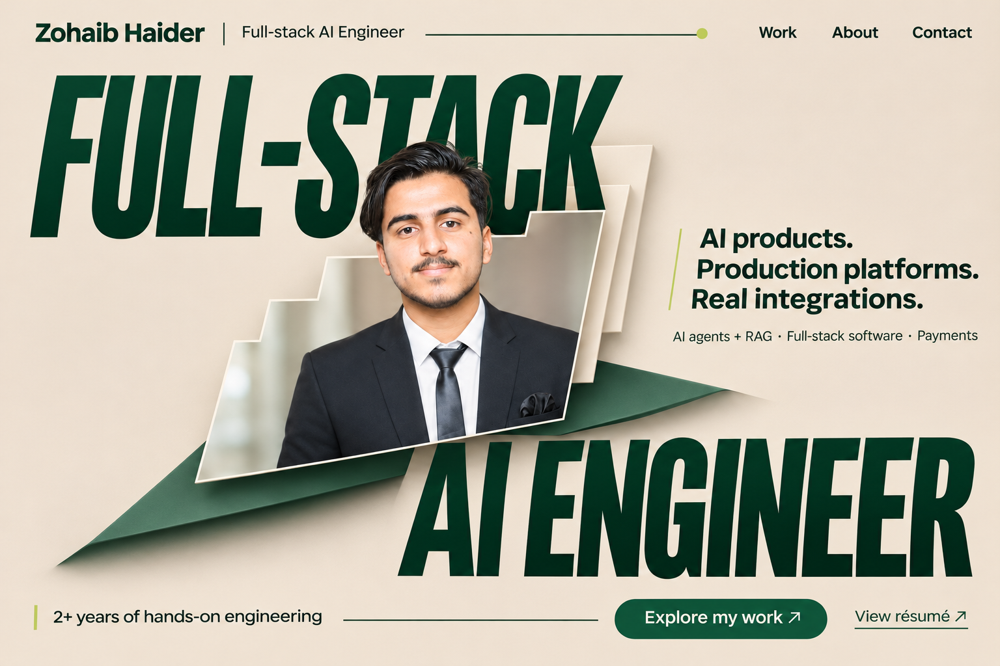
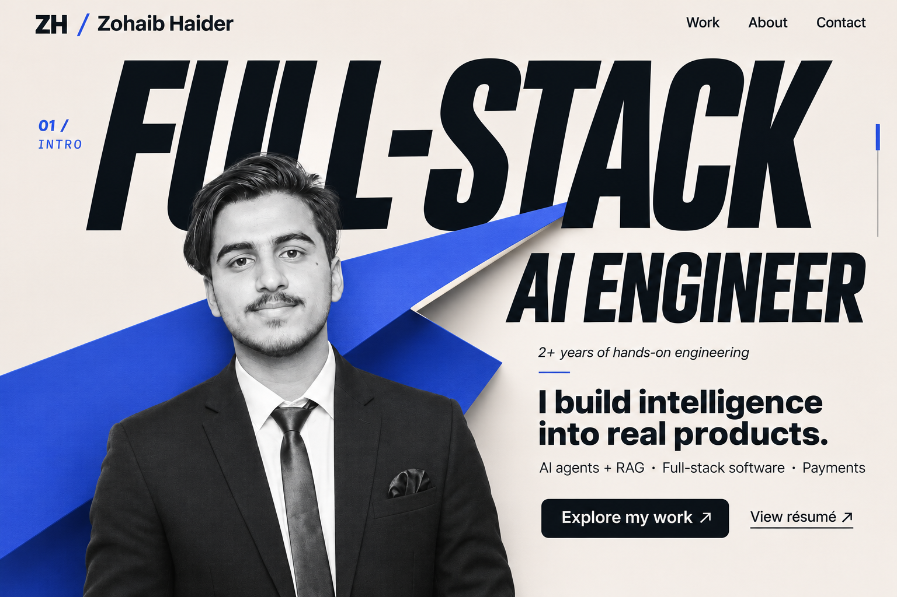
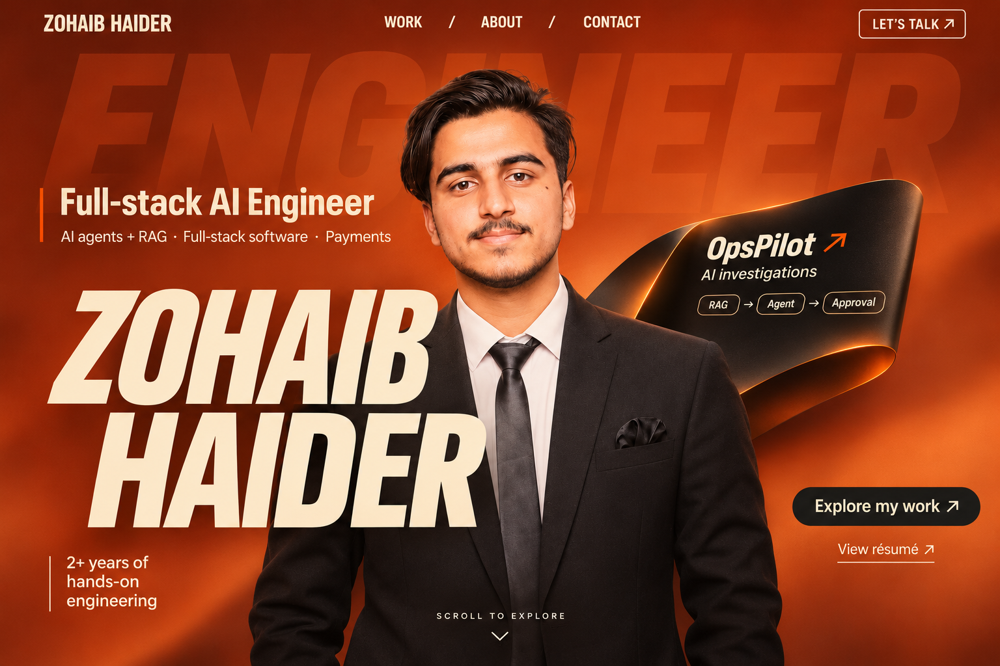
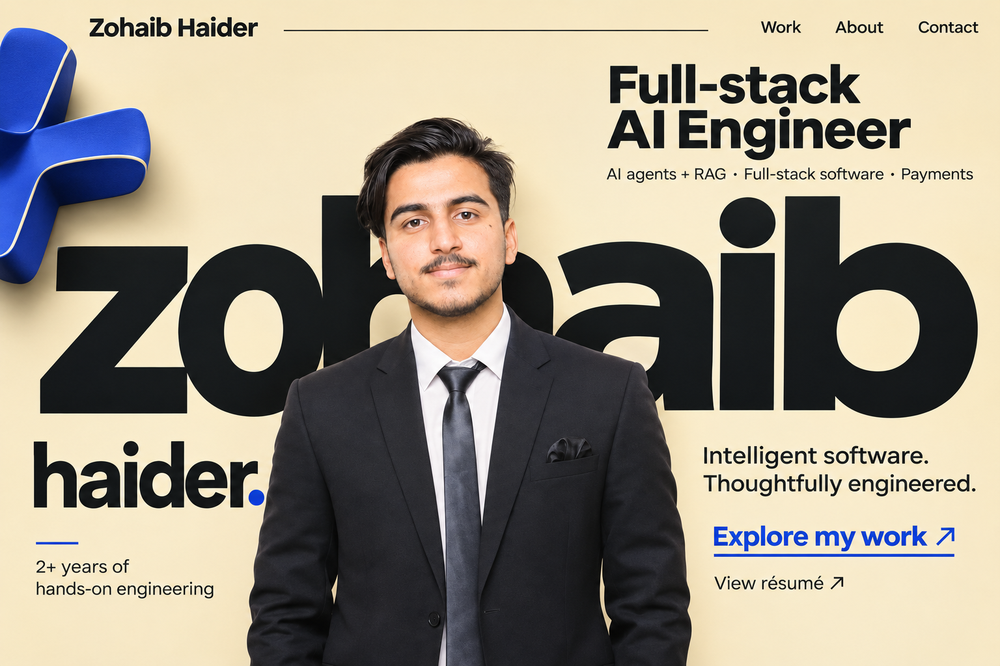
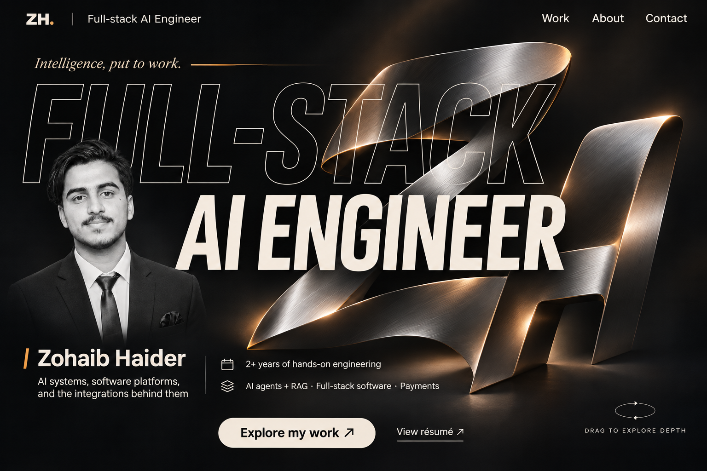

# Five final hero concepts

This set refines the five directions the user selected: Form, Axis, Ember, Pace, and Aperture. Each hero combines selected qualities into a more resolved composition, with an original portrait-led identity and a limited amount of factual content.

The first view is intended to communicate:

- **Who:** Zohaib Haider.
- **Role:** Full-stack AI Engineer.
- **Scope:** AI agents and RAG, full-stack software, payment integrations.
- **Experience:** 2+ years of hands-on engineering, following the user's description.
- **Next step:** inspect work or view a résumé.

These are static hero mockups created using the built-in image generation tool through the imagegen skill. They are not implemented websites or running animations. [Motion specifications](./MOTION.md), [typography and color direction](./TYPOGRAPHY.md), and [exact generation prompts](./prompts.json) are included. Product case studies remain below the hero in a later build.

## 01 — Forest / Sculpted Identity

Sand and forest, stepped portrait depth, large compressed role typography, and a restrained sculptural backing form. The architectural option.

## 02 — Cobalt / Kinetic Architecture

Porcelain and cobalt, a folded diagonal plane, grayscale portrait, and bold role typography. The graphic, energetic option.

## 03 — Ember / Signature in Motion

Orange photographic depth, a personal name treatment, and one compact OpsPilot proof teaser. The expressive portrait-led option.

## 04 — Pace / Personal Authority

Warm butter, a cobalt sculptural mark, natural portrait, and a crafted lowercase name composition. The personable editorial option.

## 05 — Alloy / Intelligence Studio

Dark gallery, an original metal monogram, large role typography, and a smaller portrait signature. The cinematic dimensional option.

## Review notes

The portrait reference is the original source photograph. No inflated revenue, users, awards, clients or job seniority are introduced. Contact actions are generic labels; résumé and work actions describe intended navigation for the later build.

OpsPilot is the AI incident investigation platform. Its proof teaser indicates retrieval, agent reasoning, and human approval. It does not claim autonomous sensitive financial execution.

No portfolio application source code is changed in this design round.

