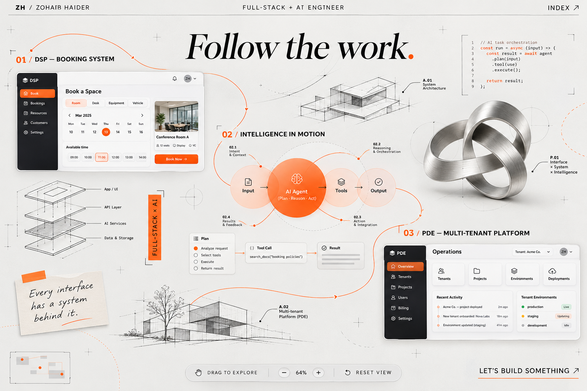
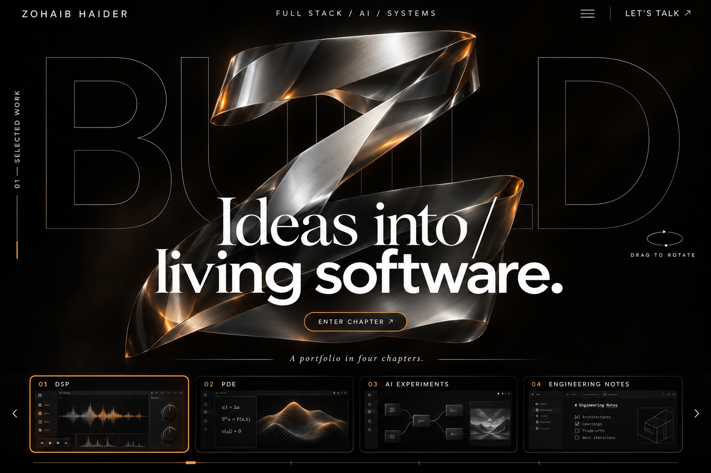
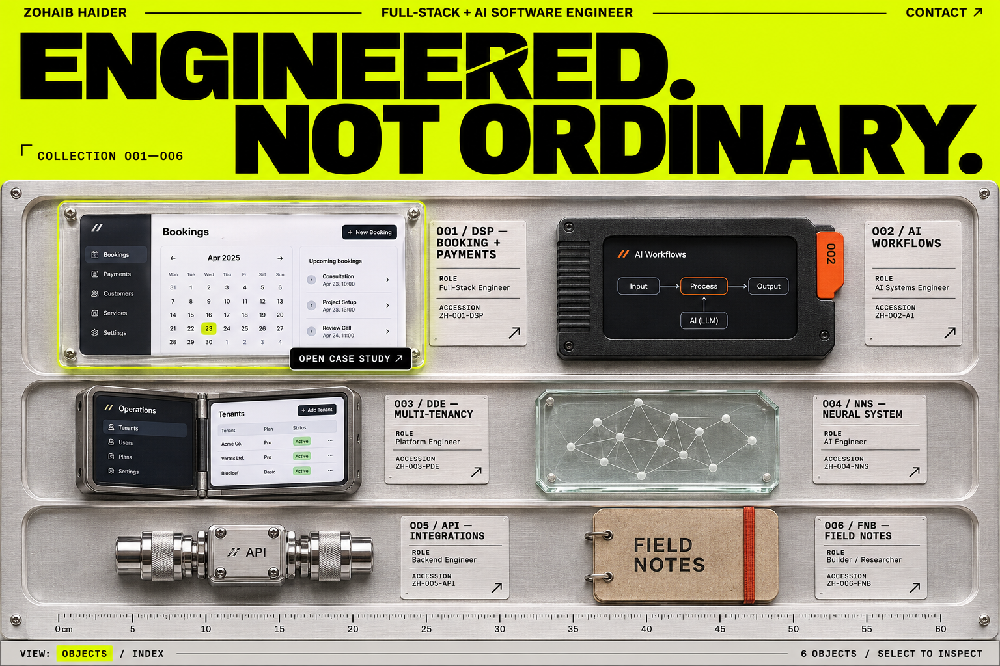
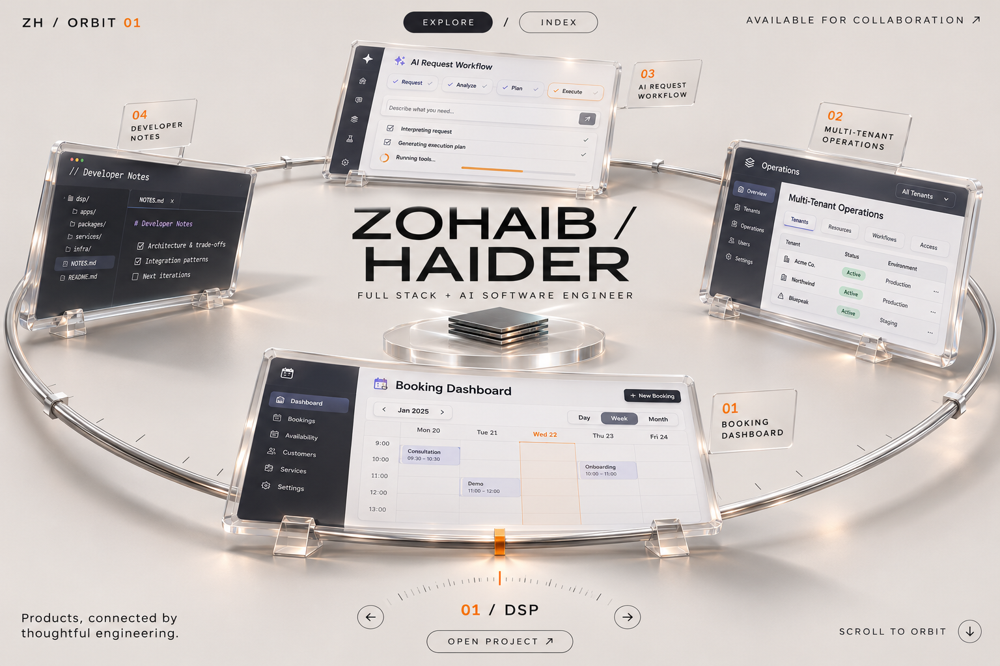
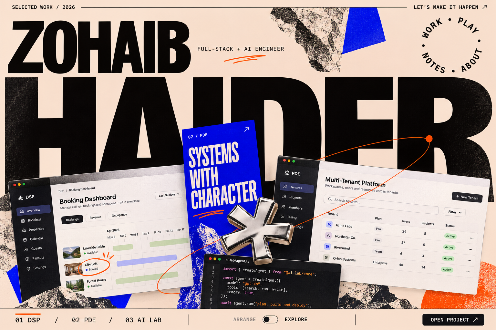

# Round 02 — experimental portfolio compositions

Five original visual directions for Zohaib Haider, full-stack AI software engineer. This round explores the layout and navigation of the whole viewport, following the request for compositions beyond a left-hand headline and right-hand illustration.

Generated with the built-in image generation tool through the imagegen skill. Exact prompts are in [prompts.json](./prompts.json). These are static visual concepts: the interactions described here are proposed behavior. Product interfaces shown inside the concepts are illustrative placeholders.

## 04 — Nonlinear

**Composition:** a full-screen, explorable canvas. Product interfaces, architecture sketches, annotations, and small experiments form connected clusters across the viewport. A minimap and a compact zoom control help visitors navigate.

**Visual identity:** cool gray, graphite, safety orange, fine paths, brushed metal, and sharply typeset labels.

**Signature interaction:** drag between products, zoom into a project, and follow its connection to the API, data, and AI workflow. A project opens as a focused case study without losing its position on the map. An index offers direct access to every project.

**What makes it distinctive:** the work itself forms the layout and the navigation. Each project can have a different visual footprint and a meaningful place in the system.

## 05 — Aperture

**Composition:** one cinematic frame with a centered chrome sculpture, large layered typography, and a horizontal project filmstrip. Navigation lives at the edges.

**Visual identity:** obsidian black, white, chrome, soft amber, gallery lighting, and controlled reflections.

**Signature interaction:** scrub through project chapters. Each chapter changes the central visual and reveals a short product demonstration; select the chapter to open its case study. Scroll and keyboard controls both advance the sequence.

**What makes it distinctive:** a portfolio presented as an authored sequence, with each project receiving an entire scene.

## 06 — Cabinet of Systems

**Composition:** an oversized typographic masthead above a tactile specimen collection. Products appear as numbered artifacts mounted in an industrial archive tray.

**Visual identity:** acidic chartreuse, black, aluminum, clear acrylic, accession labels, and condensed typography.

**Signature interaction:** select an artifact to lift and inspect it. Rotate or turn it over to reveal the architecture and implementation decisions. An alternate index provides an immediate list of case studies.

**What makes it distinctive:** treats engineering work as a collection of carefully made objects, each with its own purpose, material, and story.

## 07 — Orbit

**Composition:** a full-screen circular exhibition with software interfaces arranged around an elliptical chrome track. The engineer's name occupies the central negative space.

**Visual identity:** bone white, midnight ink, chrome, clear display surfaces, soft physical shadows, and a saffron active marker.

**Signature interaction:** scroll or drag to orbit the collection. The selected product moves to the front, straightens for readability, and opens into a case study. A compact dial communicates the current selection.

**What makes it distinctive:** the entire page has a spatial rhythm and a clear active project, without requiring a conventional vertical hero.

## 08 — Off Grid

**Composition:** oversized name typography, tilted product windows, annotations, and a sculptural asterisk form a carefully arranged collage across the full viewport.

**Visual identity:** pale peach, charcoal, electric cobalt, small orange marks, condensed type, and chrome.

**Signature interaction:** select a project window to bring it forward and straighten it for inspection. Arrange mode allows playful movement; explore mode focuses the selected case study. Project links remain available in a stable bottom index.

**What makes it distinctive:** personal identity, real software, and typographic composition share the same visual space.

## Shared implementation principles

- Keep the name, engineering role, and direct project access visible.
- Build each selected case study around the actual product, contribution, technical decisions, and demonstrated outcomes.
- Give AI experiments real inputs, outputs, and explanations of how they integrate with the product.
- Use focus, zoom, and movement to reveal information, with readable resting states.
- Adapt complex spatial views into deliberate mobile layouts and support reduced motion.
- Use real product screenshots in an implementation; the generated previews are visual placeholders.
