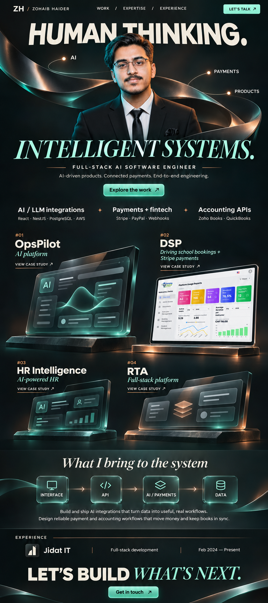
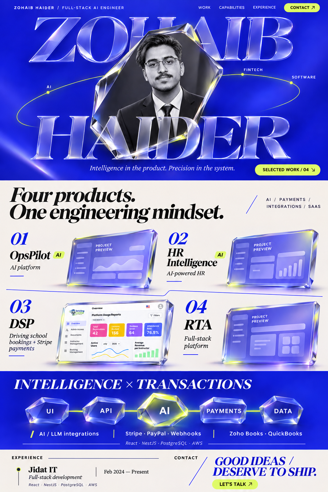
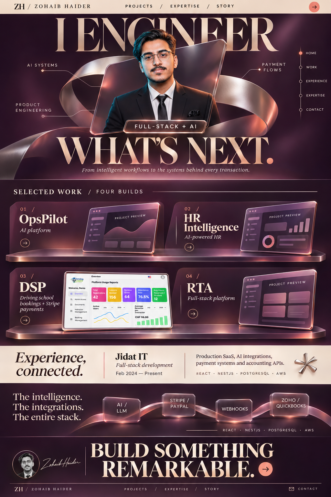
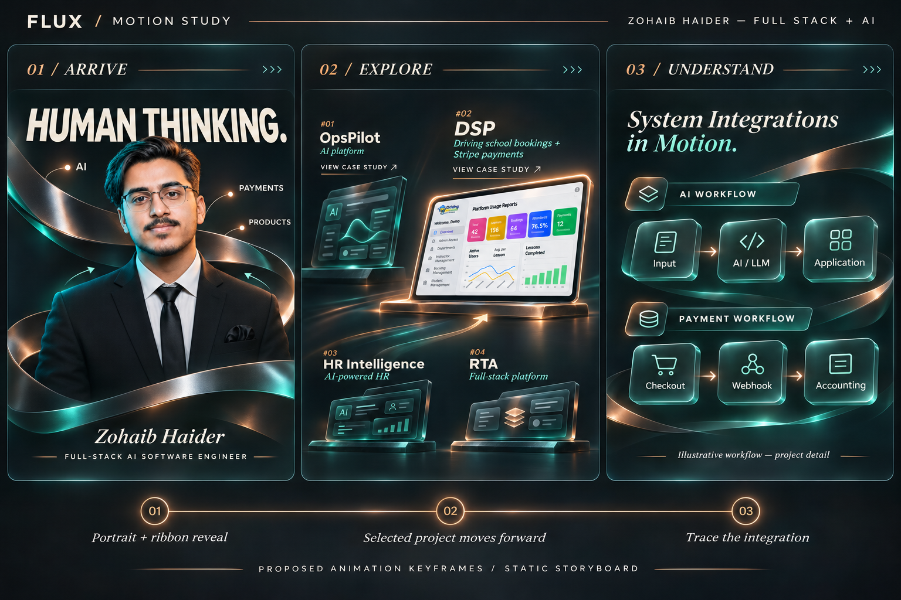

# Round 03 — portrait, AI, payments, and four real projects

This round follows the requested project selection: **OpsPilot, DSP, RTA, and HR Intelligence**. OpsPilot and HR Intelligence are AI projects. DSP's existing repository content supplies the booking and Stripe payment details. RTA's description remains a general full-stack platform label until its specific purpose is supplied.

These are full-page static visual concepts with proposed 3D animation directions. No portfolio implementation is included. Created with the built-in image generation tool through the imagegen skill; exact generation prompts are in [prompts.json](./prompts.json).

## Portrait and project references

- Identity reference: the existing `src/assets/zohaib-haider-clean.png` portrait.
- Product reference: the existing `src/assets/projects/dsp-cover.png` driving-school dashboard.
- OpsPilot, HR Intelligence, and RTA use illustrative interface placeholders, because their screenshots have not been provided for this design round.
- Experience and integration references: `src/components/portfolio/Experience.tsx`, `src/components/portfolio/About.tsx`, and `src/lib/projects.ts`.
- The project list follows the user's clarification rather than the repository's previous six-project list.

## 09 — Flux

An integrated centered portrait, flowing architectural ribbon, large typography, and four project exhibits. The design connects the person behind the work to AI products and financial integrations.

| Role | Color |
| --- | --- |
| Background | Graphite `#0B1110` |
| Primary accent | Sea glass `#8CE3CB` |
| Secondary accent | Copper `#C98A61` |
| Text | Chalk `#F3F1E8` |

**Proposed motion:** the ribbon draws into the scene, reveals the portrait, and branches toward AI, payments, and product labels. On scroll, the camera moves toward the selected project; the screen settles straight enough to read. Fine signals continue into the expertise section, linking interfaces to APIs, AI/payment integrations, and data.

**Why this palette:** sea glass and copper complement the existing portrait lighting and give AI and payment pathways distinct accents.

## 10 — Prism

A bold ultramarine portrait stage, sculptural chrome portal, large personal typography, and a porcelain project index. Strong color blocking creates a clear change from introduction to evidence.

| Role | Color |
| --- | --- |
| Primary surface | Ultramarine `#243BFF` |
| Reading surface | Porcelain `#F5F1E9` |
| Text | Ink `#121212` |
| Active accent | Acid lemon `#DEFF79` |

**Proposed motion:** the portrait portal turns slightly into its resting position while large letters reveal in depth. Project planes rise gently as their chapter enters the viewport. Optical prisms pass a signal through UI, API, AI, payments, and data. The background changes by section rather than through continuous flashing.

**Why this palette:** the bright opening creates a strong personal identity, while the light project sections give case studies a comfortable reading surface.

## 11 — Nocturne

A luxurious portrait-led gallery with aubergine, champagne, sculptural platinum, and coral accents. Separate stages introduce the two AI products and the other two platforms.

| Role | Color |
| --- | --- |
| Background | Aubergine `#241A25` |
| Light surface and text | Champagne `#F0E4D2` |
| Supporting accent | Dusty rose `#C9A6B2` |
| Active accent | Coral `#FFA68B` |

**Proposed motion:** a suspended portrait plate shifts gently with pointer movement. The architectural arch opens as the hero leaves view. Each project moves from a three-quarter gallery angle into a readable frontal view when selected. A warm experience panel gives the page a quieter pause before the integration sequence and contact section.

**Why this palette:** warm typography and restrained coral accents make the page feel personal and stylish, with enough contrast to support dense engineering content.

## Four-project content plan

| Project | What the design should communicate | Detail status |
| --- | --- | --- |
| OpsPilot | AI platform | Confirmed as an AI project by the user; specific features and screenshots to follow. |
| HR Intelligence | AI-powered HR | Confirmed as an AI project by the user; specific features and screenshots to follow. |
| DSP | Driving-school booking, Stripe checkout, delayed charging, refunds, payouts, webhooks | Supported by existing project content. |
| RTA | Full-stack platform | Name confirmed; description and screenshots to follow. |

## Make the experience clear

Every direction gives visible space to the portrait, all four projects, AI/LLM integrations, payment and accounting integrations, and professional experience. A detailed case study should answer:

1. What problem does the product solve?
2. What did Zohaib personally build?
3. Where do AI, payment, and external integrations fit?
4. What technical decisions mattered?
5. What evidence can a visitor inspect or try?

Do not add AI features to a project without confirming them. In particular, do not assume every project includes agents, RAG, autonomous decisions, or model training.

## Motion storyboard for the later build

This additional design sheet shows three proposed keyframes: arrival, project selection, and integration explanation. It is a static storyboard, not a rendered animation. Its exact generation prompt is in [motion-prompt.txt](./motion-prompt.txt).

| Moment | Visual action | Purpose |
| --- | --- | --- |
| Arrival | Name and role appear first; the portrait and 3D structure then settle into view. | Establish identity immediately. |
| Pointer movement | Small depth changes in the sculptural layer; portrait remains clear and readable. | Add tactile depth without moving essential text. |
| Scroll into work | Hero structure separates into the project gallery. | Connect the introduction to evidence. |
| Project focus | The selected screen moves forward and straightens; title, role, and opening link stay stable. | Make the selected work easy to inspect. |
| AI explanation | A labeled sample signal moves from input through the AI/LLM integration to an application output. | Show where AI contributes, using a confirmed workflow in the eventual build. |
| Payment explanation | A labeled sample event moves through checkout, webhook handling, and accounting sync. | Explain the integration work; use the actual relevant project flow in a case study. |
| Experience | Timeline and responsibility labels reveal with restrained movement. | Communicate professional depth. |
| Contact | Composition resolves into a clear invitation and direct links. | Give the visitor a straightforward next step. |

Long-running 3D movement should be subtle. Preserve stable reading positions, direct project links, mobile layouts, and reduced-motion alternatives when implementing later.
