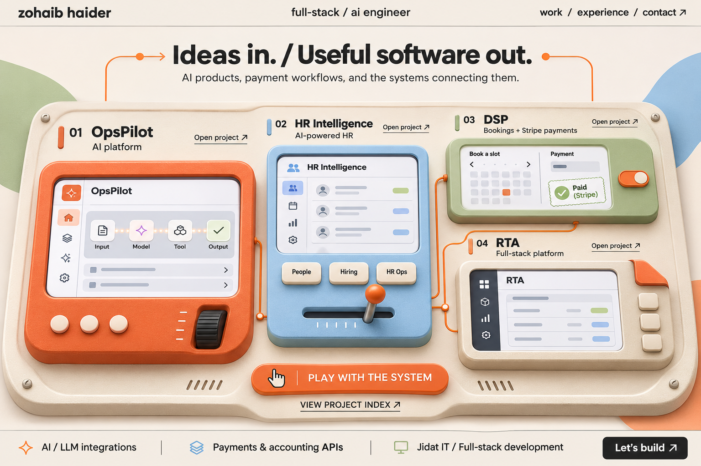
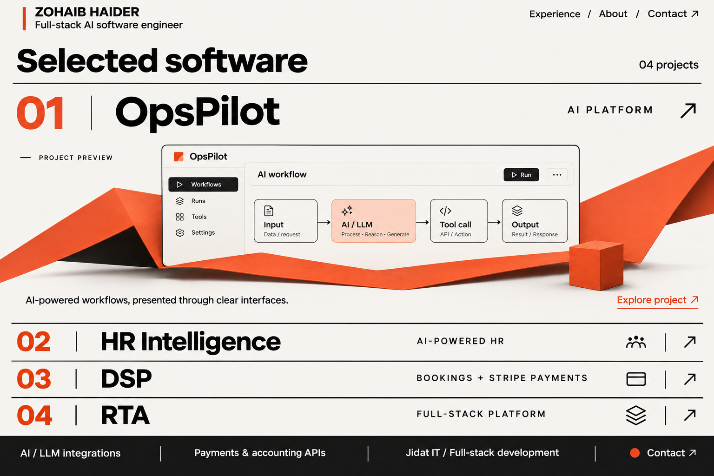
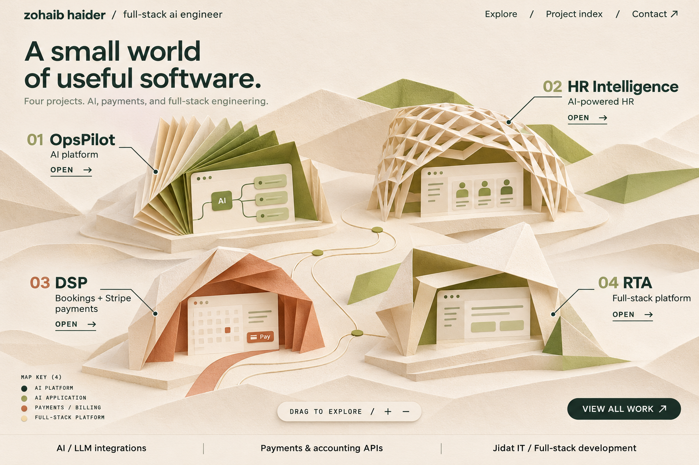

# Round 04 — a different visual direction

This round follows the latest direction: no photograph or avatar, fresh typography, and a different visual niche. The design references are tactile instruments, editorial project indexes, and sculpted paper landscapes. The earlier metallic portrait direction is not used.

Created with the built-in image generation tool through the imagegen skill. Exact prompts: [prompts.json](./prompts.json). These are static website mockups; motion described below is proposed for a later implementation.

## 13 — Switchboard

**Visual identity:** cream, ink, persimmon, sky blue, and sage. Clean contemporary sans-serif typography. Matte painted surfaces, tactile controls, and a single shared instrument surface.

**Layout:** four different project mechanisms span the page. Each belongs to a named product and has a clear opening link. The work becomes the interface.

**Proposed motion:** a pointer gently shifts the instrument's perspective. Selecting a project animates its control and expands a readable case study. Small signal paths demonstrate a confirmed product workflow. Direct project links stay available.

**Distinctive quality:** a playful engineering identity built through physical interaction and purpose, without a portrait.

## 14 — Index / One

**Visual identity:** warm white, ink, and one red-orange accent. Precise modern sans-serif typography, fine rules, and concise metadata.

**Layout:** an immediately visible project index with four large accordion rows. One expanded row presents its project across the full width. There is no separate decorative hero.

**Proposed motion:** selecting a row smoothly reallocates space to that project. Matte folded surfaces and interface layers reveal the selected workflow. The title, category, and case-study link retain readable resting positions.

**Distinctive quality:** visual confidence through typography and layout, with the actual engineering work taking priority.

## 15 — Paperworld

**Visual identity:** ivory, forest green, moss, terracotta, and butter. Humanist sans-serif typography and tactile folded paper.

**Layout:** one continuous sculpted-paper canvas with four distinct project portals and clearly readable flat navigation labels. The connecting paths suggest the relationships in software systems.

**Proposed motion:** drag gently changes the view. A selected paper pavilion unfolds into a project preview; choosing its opening action reveals a case study. The project index offers direct access.

**Distinctive quality:** a calm, crafted spatial identity with a material language different from the earlier glass and metal designs.

## Content carried forward

| Project | Confirmed design label |
| --- | --- |
| OpsPilot | AI platform |
| HR Intelligence | AI-powered HR |
| DSP | Bookings + Stripe payments |
| RTA | Full-stack platform |

The designs also provide a place for AI/LLM integrations, payment and accounting APIs, and professional experience. Product previews are illustrative. RTA's industry and specific features remain unconfirmed. This round changes the visual direction; it does not implement the portfolio.
