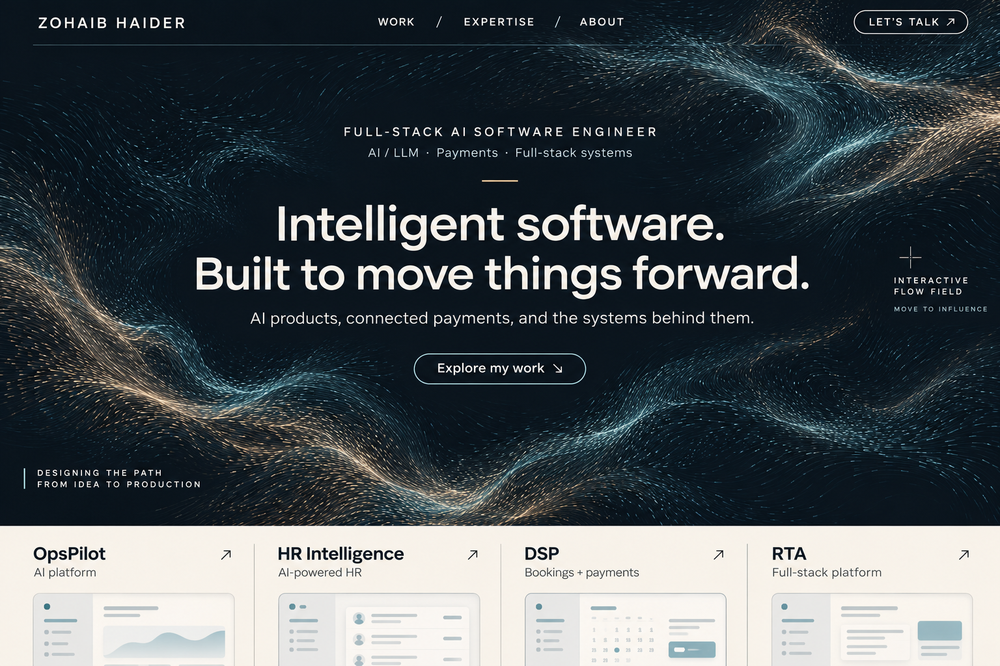
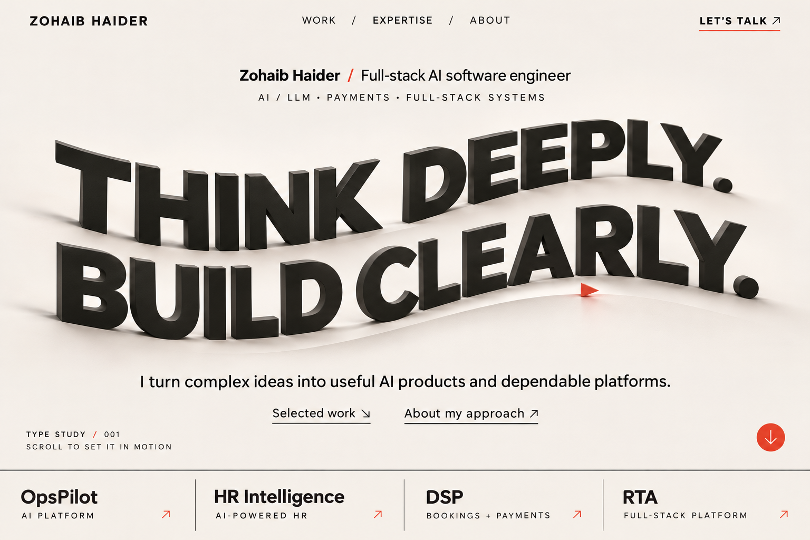
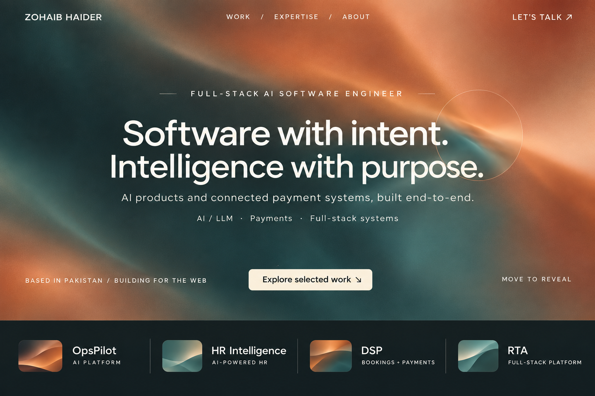
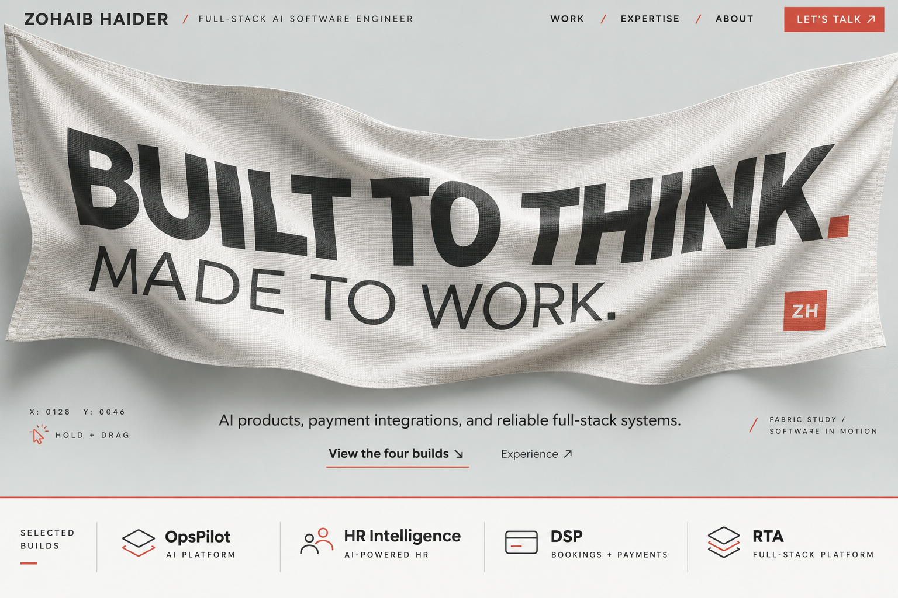
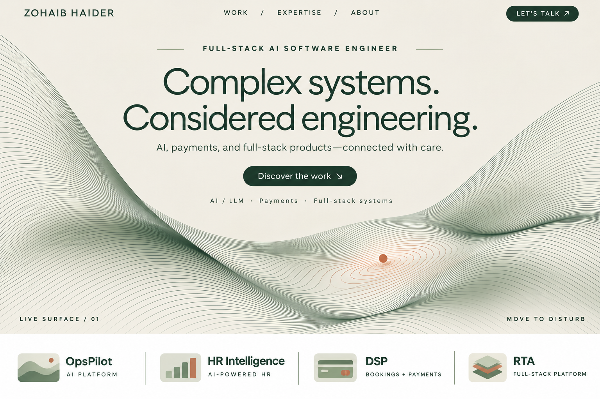
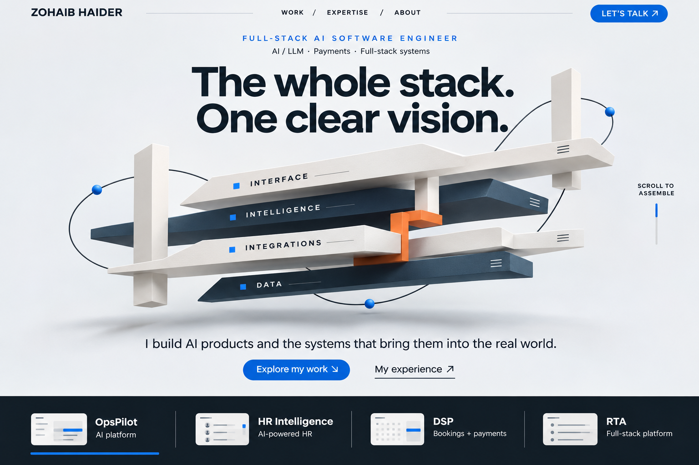
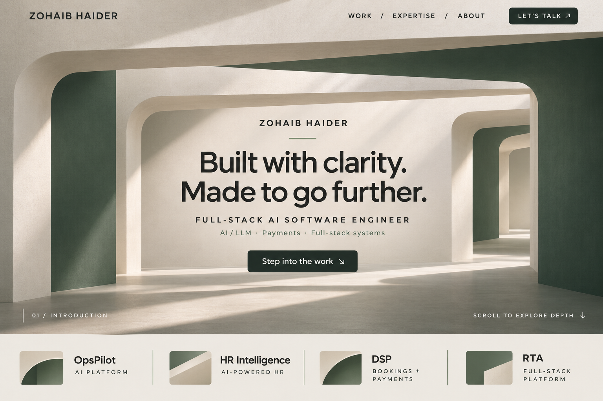
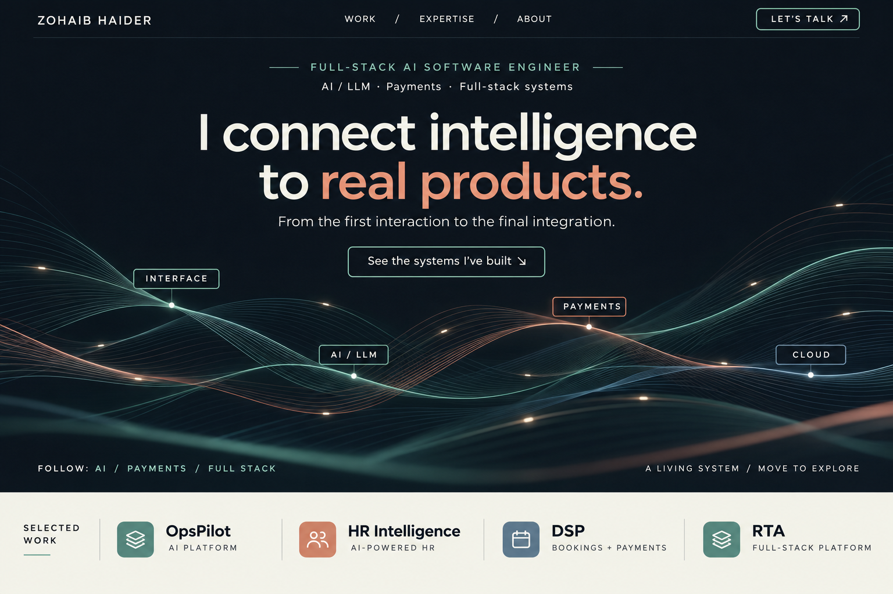

# Round 05 — eight hero directions

This round focuses on the landing hero. The four project names remain visible: **OpsPilot, HR Intelligence, DSP, and RTA**. No portrait is used. These are eight original static visual concepts created using the built-in image generation tool through the imagegen skill. Proposed animations are described below; the referenced live sites and demos show actual motion. Coding remains for later.

Read [the research and source notes](./RESEARCH.md) for the reference comparison, inspection scope, design conclusions, and additional live motion examples. The [exact generation prompts](./prompts.json) are saved alongside the designs.

| Design | Proposed motion | Reference |
| --- | --- | --- |
| [Stream](./16-stream.png) | Fine particles follow a living flow field; pointer interaction bends the field, which gently reforms. | [Live reference](https://pavelmazhuga.com/lab/) |
| [Kinetic](./17-kinetic.png) | Matte letter forms rise and settle in a travelling wave; the foreground identity remains stable. | [Live reference](https://tympanus.net/codrops/hub/) |
| [Current](./18-current.png) | A slowly evolving color field responds to a soft cursor lens; scroll opens the project gallery. | [Live reference](https://monopo.london/) |
| [Fold](./19-fold.png) | An oversized fabric banner responds to virtual wind and pointer movement, then stretches into the first project. | [Live reference](https://www.juanmoraromero.com/) |
| [Contour](./20-contour.png) | A continuous 3D contour surface ripples softly; cursor pressure sends a travelling deformation across it. | [Live reference](https://pavelmazhuga.com/lab/) |
| [Assembly](./21-assembly.png) | Matte components assemble into a single system, then separate into project chapters on scroll. | [Live reference](https://lusion.co/) |
| [Lightwell](./22-lightwell.png) | A slow camera move through a sculptural corridor creates depth; project previews emerge at its openings. | [Live reference](https://unseen.co/) |
| [Relay](./23-relay.png) | Signals travel along continuous routes; selecting AI or payments highlights its path and relevant projects. | [Live reference](https://tympanus.net/codrops/hub/) |

## Palette and direction

| Design | Palette | Character |
| --- | --- | --- |
| Stream | Deep ink, ice blue, porcelain, pale sand | A technical but organic particle current |
| Kinetic | Warm white, ink, signal red | A bold typographic sculpture |
| Current | Charcoal, muted teal, apricot, burnt orange | A warm atmospheric identity |
| Fold | Mineral gray, charcoal, vermilion | A tactile cloth-based opening |
| Contour | Ivory, forest, sage, terracotta | Calm parametric precision |
| Assembly | Porcelain, midnight, azure, orange | A visible system of connected layers |
| Lightwell | Chalk, charcoal, muted green, warm light | Quiet architectural depth |
| Relay | Midnight, white, sage teal, coral | Flowing paths connecting AI and integrations |

My design assessment: **Relay** most directly connects the visual idea to AI and payment integrations; **Current** provides the strongest atmospheric color alternative; **Stream** emphasizes continuous generative motion. **Fold** and **Kinetic** are the most overtly experimental openings. These are subjective judgments for choosing a direction.

## Stream

Fine particles follow a living flow field; pointer interaction bends the field, which gently reforms.

## Kinetic

Matte letter forms rise and settle in a travelling wave; the foreground identity remains stable.

## Current

A slowly evolving color field responds to a soft cursor lens; scroll opens the project gallery.

## Fold

An oversized fabric banner responds to virtual wind and pointer movement, then stretches into the first project.

## Contour

A continuous 3D contour surface ripples softly; cursor pressure sends a travelling deformation across it.

## Assembly

Matte components assemble into a single system, then separate into project chapters on scroll.

## Lightwell

A slow camera move through a sculptural corridor creates depth; project previews emerge at its openings.

## Relay

Signals travel along continuous routes; selecting AI or payments highlights its path and relevant projects.

## Carrying the hero into the portfolio

The hero is one part of the page. After choosing a direction, pair it with the project exhibit style the user liked, then refine case-study detail, expertise, experience, and contact. Keep essential role and navigation text stable while the selected motion system evolves around it.

Product thumbnails here are illustrative, not exact screenshots. OpsPilot and HR Intelligence remain AI projects; DSP remains the booking/payment platform; RTA uses a general full-stack label until its specific description is confirmed.

