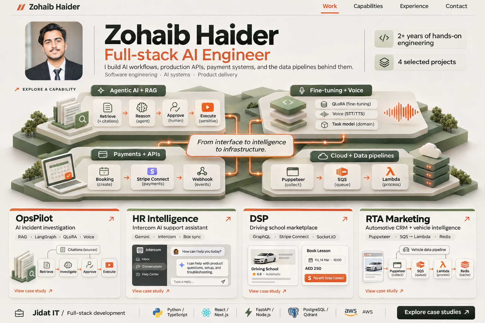

# Round 06 — personal identity with engineering evidence

**Stopped at the user's request.** The first view was too dense. Proof was saved before the interruption; the other three entries below are prompt directions, with no saved final images in this folder. The latest exploration is [the quieter hero in Round 07](../round-07-quiet-hero/README.md).

The latest brief restores the portrait and asks the first view to communicate the engineer's role, approximately two years of work, real AI depth, full-stack skills, and four projects. These designs use the original source portrait and the supplied project notes.

Created with the built-in image generation tool through the imagegen skill. Exact prompts are in [prompts.json](./prompts.json). These are static design concepts with proposed 3D motion; coding remains for later. Project interface fragments are illustrative and should be replaced by real product captures in an implementation.

The content model and supporting project details are in [CONTENT.md](./CONTENT.md). The user-provided project notes are preserved in [provided-project-notes.txt](./provided-project-notes.txt).

## 24 — Proof / Engineering Dossier

**Direction:** light editorial engineering dossier. Warm offwhite, charcoal, moss, and a restrained orange accent. A compact portrait byline, clear name/role, a dimensional capability map, and concrete project evidence.

**Proposed motion:** one selected capability rises gently from the map. Signals trace its real workflow and highlight the corresponding projects. Scroll resolves the map into a case study. Identity text remains stable.

## 25 — Trace / AI Systems Studio

Prompt direction only; no saved final image.

**Direction:** dark, precise AI systems portfolio. An editorial portrait tile and clear identity share the opening with a full-width operational trace. The trace makes RAG, reasoning, human approval, voice and model work visible.

**Proposed motion:** a selected investigation travels through retrieval and reasoning, pauses at approval, then shows verified execution. Voice and fine-tuning routes can be explored independently. The visual must communicate the approval boundary.

## 26 — Profile / Contemporary Engineer

Prompt direction only; no saved final image.

**Direction:** contemporary personal brand with a full-width name composition, natural portrait, porcelain, ink, periwinkle, and tomato accents. Dimensional typographic capability blocks and a precise project index provide the evidence.

**Proposed motion:** a selected capability block shifts into focus, reveals its workflow, and expands the relevant project row. Small movement in the physical type gives the page personality while keeping the identity readable.

## 27 — Observatory / Spatial Portfolio

Prompt direction only; no saved final image.

**Direction:** immersive spatial engineering exhibit. The portrait anchors connected project systems, and a flat index beneath the scene explains all four products. Midnight indigo, warm white, sky, and soft amber.

**Proposed motion:** a camera movement focuses a project system. Signals follow the actual workflow; selecting its name opens the case study. The four projects remain available through a stable index.

## Shared content

- Zohaib Haider — Full-stack AI Engineer.
- 2+ years of hands-on engineering and four selected projects.
- OpsPilot: AI incident investigation, RAG, orchestration, approvals, fine-tuning and voice.
- HR Intelligence: an Intercom AI support assistant using Gemini and Box synchronization.
- DSP: driving-school marketplace, GraphQL, Stripe Connect, real-time communication.
- RTA Marketing: automotive CRM and serverless vehicle-data pipelines.
- Capabilities connect to actual projects rather than presenting every package as a headline skill.

The appearance of depth and motion in the images is a visual proposal. No new source implementation, live workflow, or actual animation is included in this design round.
