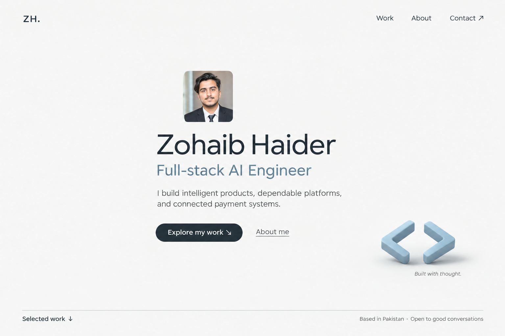

# Round 07 — quiet hero

Latest direction: a spacious first screen with a clear identity, a small natural portrait, one short introduction, and a single understated 3D detail. Detailed capabilities, experience, and the four project case studies belong below the hero.

**Identity:** Zohaib Haider — Full-stack AI Engineer.

**Palette:** cloud white, deep slate, muted steel blue, warm gray.

**Proposed motion:** a slow small rotation of the matte code-bracket sculpture, with a stable reading area. Project transitions can carry more of the motion below the opening screen.

This is a static design concept generated using the built-in image generation tool through the imagegen skill. The exact prompt is in [prompt.txt](./prompt.txt). No site implementation is included.
