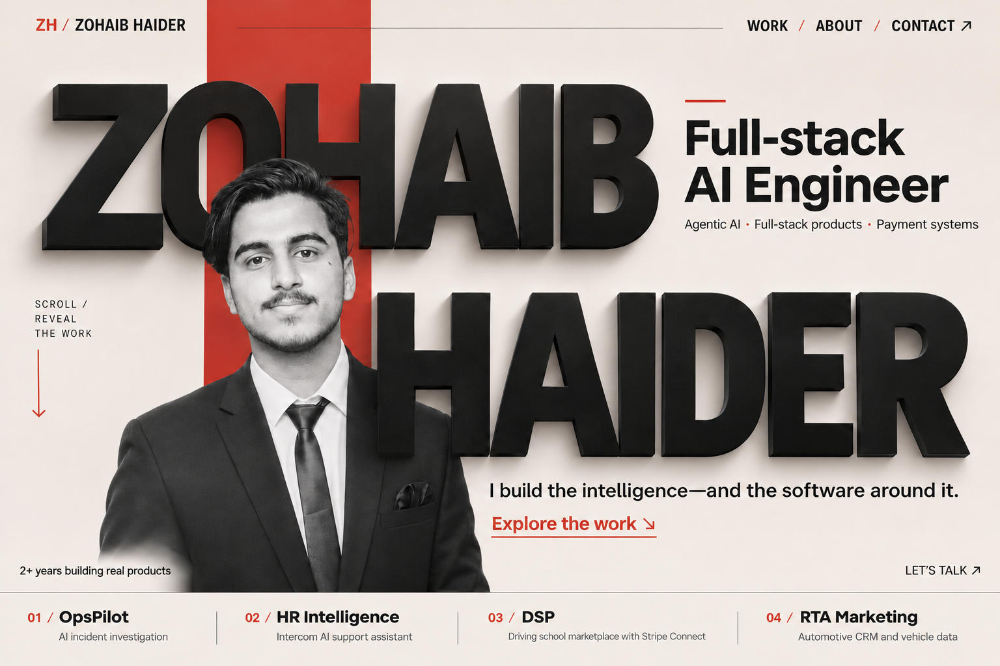
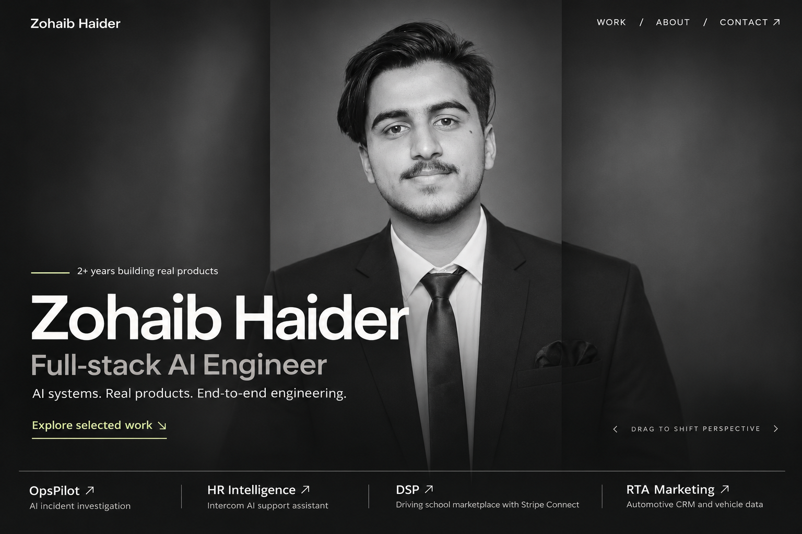
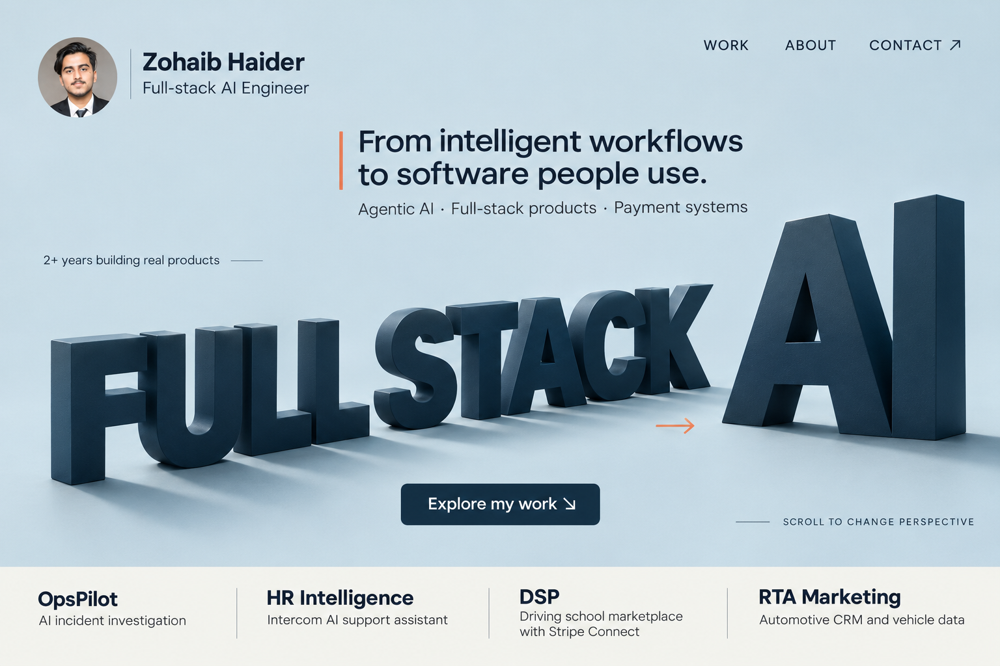
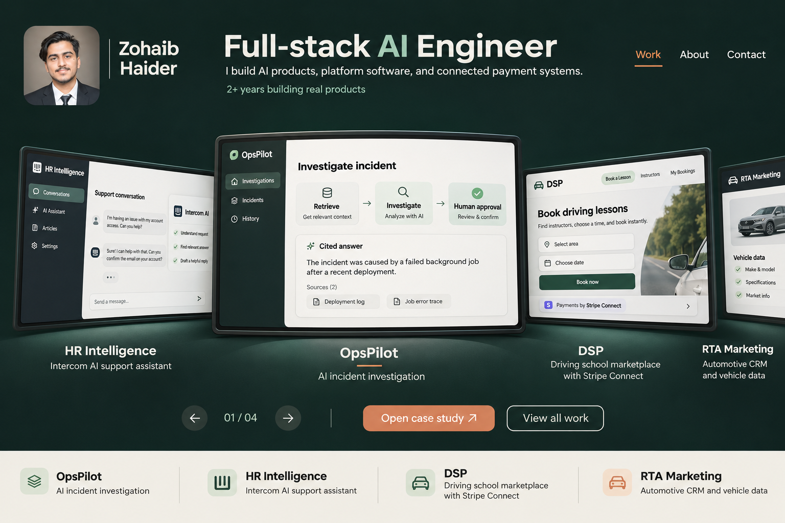
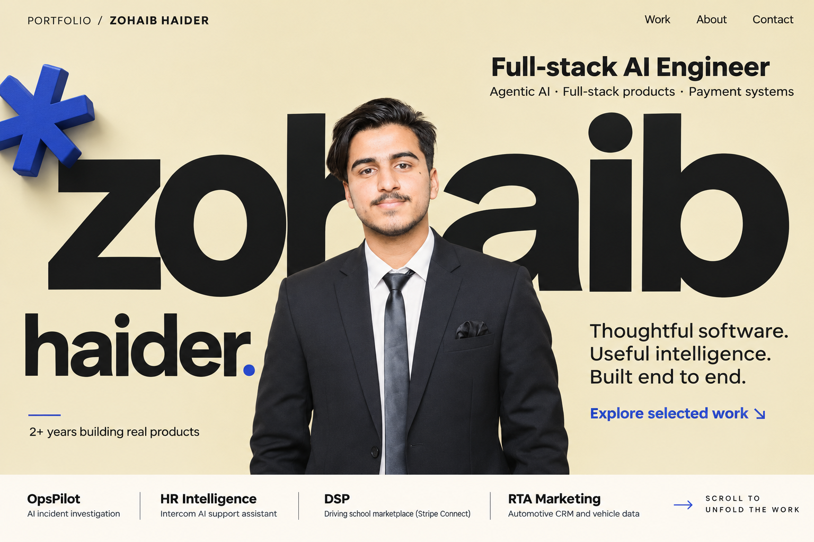

# Round 08 — five different hero directions

Five original visual concepts following the request for more variety. The first screen stays focused on personal identity and one visual idea. Detailed capability maps, dependency inventories, and project descriptions belong below the hero.

Created with the built-in image generation tool through the imagegen skill. Exact prompts: [prompts.json](./prompts.json). These are static visual concepts of proposed motion, not implemented animations or websites. The portrait reference is the original `src/assets/zohaib-haider-source.png` photograph.

Redline received a [small text correction](./redline-edit-prompt.txt) to replace an invented contact address with a generic contact action.

## 28 — Redline / Typographic Studio

Warm ivory, ink, and vermilion. The name, photograph, and matte dimensional typography form one editorial composition. Role and introduction stay readable in the negative space.

**Proposed motion:** name letters and photo shift gently through shallow depth planes as the project section enters view.

## 29 — Noir / Cinematic Portrait

A dark monochrome photographic opening with restrained pale-green accents. Broad image strips create depth while retaining one recognizable portrait and a clear role.

**Proposed motion:** subtle photographic parallax and coordinated strip transitions reveal selected work.

## 30 — Spatial Type

Powder blue, navy, and a small coral accent. Sculptural role typography occupies the scene; the portrait and name form a smaller personal signature.

**Proposed motion:** the camera changes perspective gently and letters settle into alignment on scroll. Essential identity text remains stable.

## 31 — Reel / Product-Led Portfolio

Forest-black, porcelain, and mint. A clear identity header introduces a curved gallery of project previews, bringing the software itself into the opening experience.

**Proposed motion:** scroll or drag advances the project reel. The selected preview moves forward and straightens for inspection, then opens its case study.

## 32 — Pace / Contemporary Editorial

Butter yellow, ink, and a small blue accent. An asymmetric typographic composition integrates the portrait and a restrained sculptural detail.

**Proposed motion:** subtle kinetic typography, a slow small movement of the identity detail, and a coordinated reveal into the work.

## Content kept consistent

- Zohaib Haider — Full-stack AI Engineer.
- Agentic AI, full-stack products, and payment systems.
- Two years of hands-on work, expressed as a small supporting line rather than a large counter.
- OpsPilot: AI incident investigation.
- HR Intelligence: Intercom AI support assistant.
- DSP: driving-school marketplace and Stripe Connect.
- RTA Marketing: automotive CRM and vehicle data.

The Reel preview uses illustrative product interfaces. All final case studies should use actual product screenshots and the supplied engineering details. No portfolio source code is changed by this exploration.
