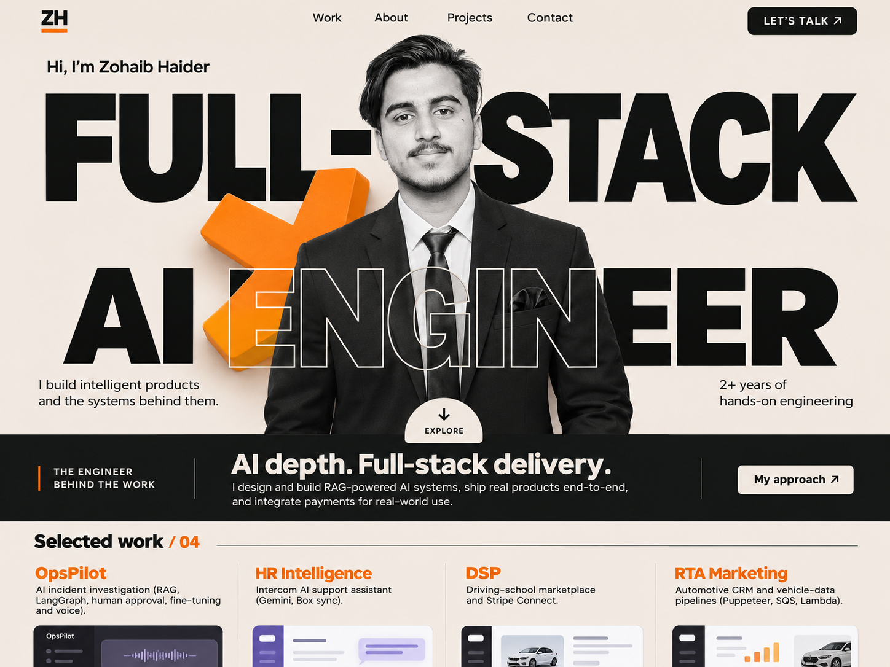
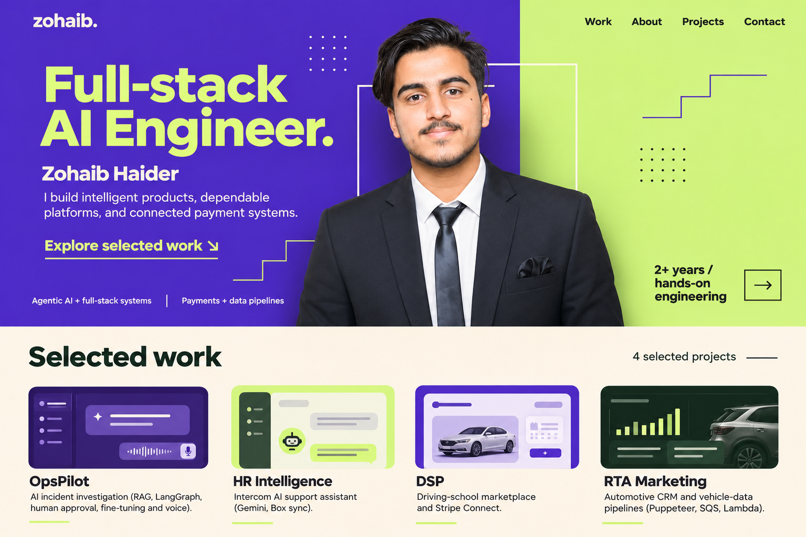
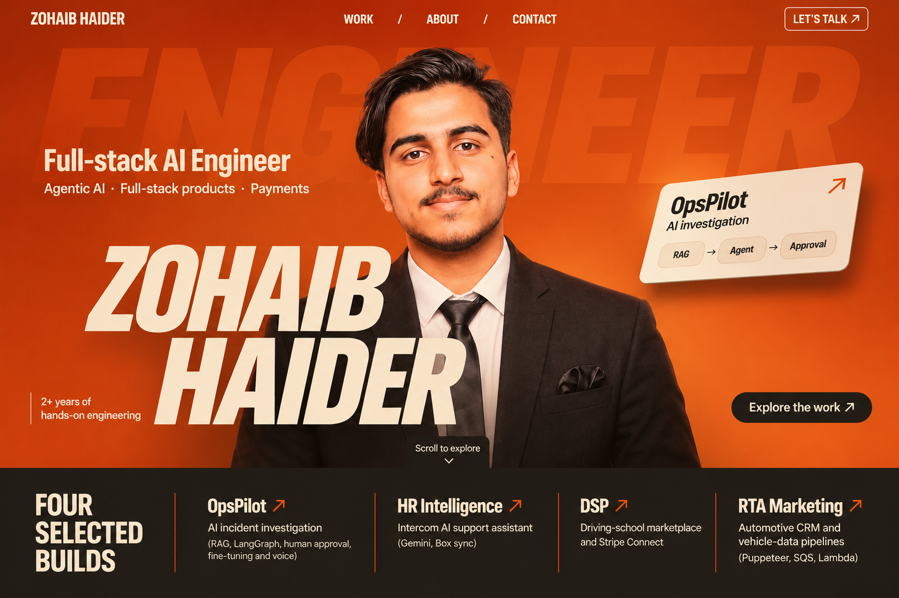
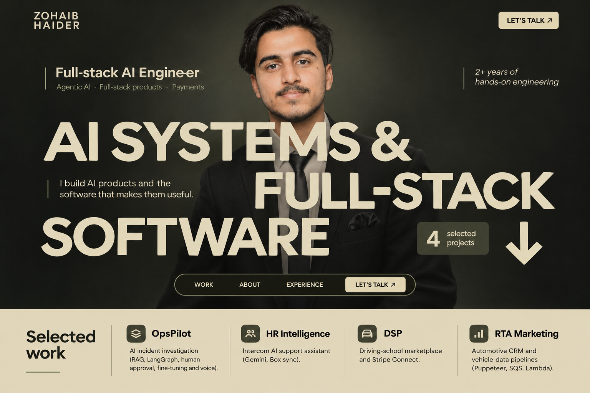
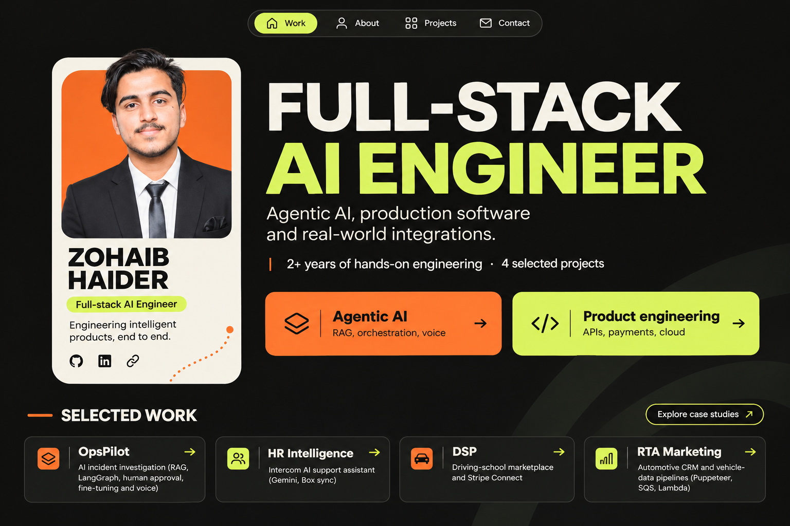
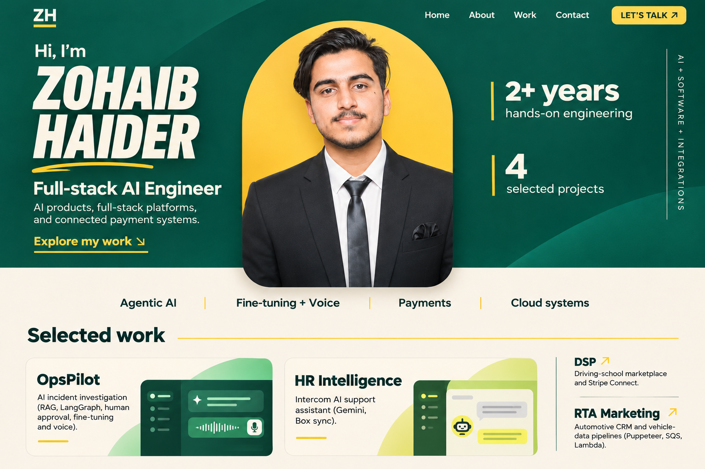

# Round 09 — six concepts based on the supplied references

This round follows the visual examples supplied by the user: bold identity typography, prominent portraits, layered cutouts, confident color blocking, focused introductions, and recognizable personal branding. The examples guide the compositions; the owner's role, experience, project names, and capabilities come from the user's own information.

Created with the built-in image generation tool through the imagegen skill. Exact prompts and proposed motion directions are in [prompts.json](./prompts.json). These are static website mockups, not implemented animations. The original source portrait was supplied as the identity reference alongside recent reference screenshots.

The screenshots represent the webpage itself, even where the source inspiration was shown inside a laptop or presentation frame. Detailed skills and workflow explanations belong below the hero.

| Concept | Reference ideas | Palette |
| --- | --- | --- |
| Outline | Ivory/black/orange portrait cutout, solid and outlined type | Ivory, nearblack, tangerine |
| Volt | Violet/lime developer layout, portrait bridging the color seam | Ultraviolet, pale lime, cream |
| Ember | Orange editorial portrait cover, large personal name | Burnt orange, warm white, charcoal |
| Olive | Dark editorial portrait and staggered cream typography | Charcoal olive, cream, moss-gray |
| Studio | Compact profile card and a restrained specialty-card layout | Nearblack, warm white, orange, lime |
| Evergreen | Green/yellow portrait arch crossing a section boundary | Emerald, sunshine, cream |

## 33 — Outline / Ivory + Tangerine

**Composition:** a portrait cutout intersects two rows of role typography. A restrained tangerine form and outlined text establish the visual identity; a short about strip and selected work follow.

**Proposed motion:** headline planes move behind the portrait; the outline layer reveals in front of the suit; the single accent form rotates subtly.

## 34 — Volt / Violet + Lime

**Composition:** the portrait bridges two color fields. The engineering role remains clear, with small supporting copy and restrained geometric detail.

**Proposed motion:** offset frame depth responds slightly to pointer movement, and fine geometric lines draw into place.

## 35 — Ember / Orange Editorial

**Composition:** an immersive orange portrait cover with a large personal name, concise role, one project teaser, and a dark selected-work band.

**Proposed motion:** a staggered name reveal, subtle portrait parallax, and one floating project teaser create shallow depth.

## 36 — Olive / Dark Editorial

**Composition:** a subdued portrait forms the background for staggered cream typography describing AI systems and full-stack software. A compact navigation dock and light project-reading surface follow.

**Proposed motion:** typography reveals through masks while the portrait moves slowly in a separate depth layer. Essential role and navigation text stay readable.

## 37 — Studio / Profile Card

**Composition:** one portrait profile card, a clear role, concise evidence, and two specialty navigation cards. The orange/lime accents are concentrated into a small number of components.

**Proposed motion:** gentle portrait-card tilt and specialty-card interaction lead into the relevant case studies.

## 38 — Evergreen / Portrait Arch

**Composition:** a yellow portrait arch crosses from an emerald hero into a cream work section. The name and role sit alongside restrained experience labels.

**Proposed motion:** the portrait arch expands slightly across the section boundary, with small depth changes in the first project previews.

## Content rules

- Zohaib Haider — Full-stack AI Engineer.
- Agentic AI, full-stack products, and payment systems.
- Two years of hands-on work; no statistics copied from the reference sites.
- OpsPilot: AI incident investigation.
- HR Intelligence: Intercom AI support assistant.
- DSP: driving-school marketplace with Stripe Connect.
- RTA Marketing: automotive CRM and vehicle data.
- Contact actions use generic labels rather than invented addresses.
- Project interface fragments are illustrative; actual product captures belong in the later build.

No portfolio application source code is changed by this design exploration.
