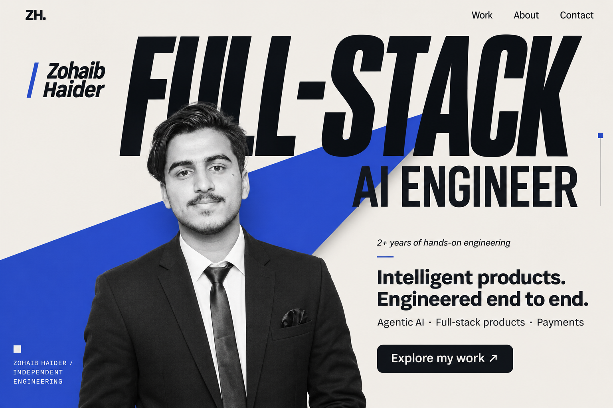
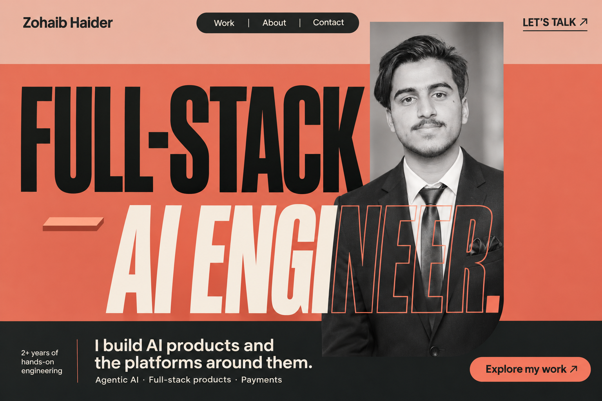
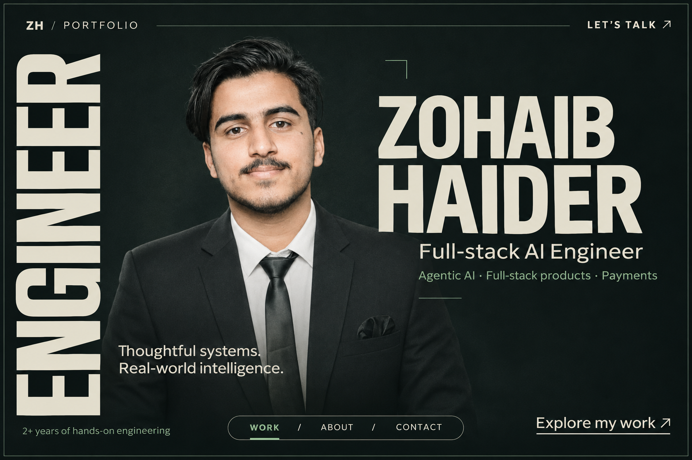
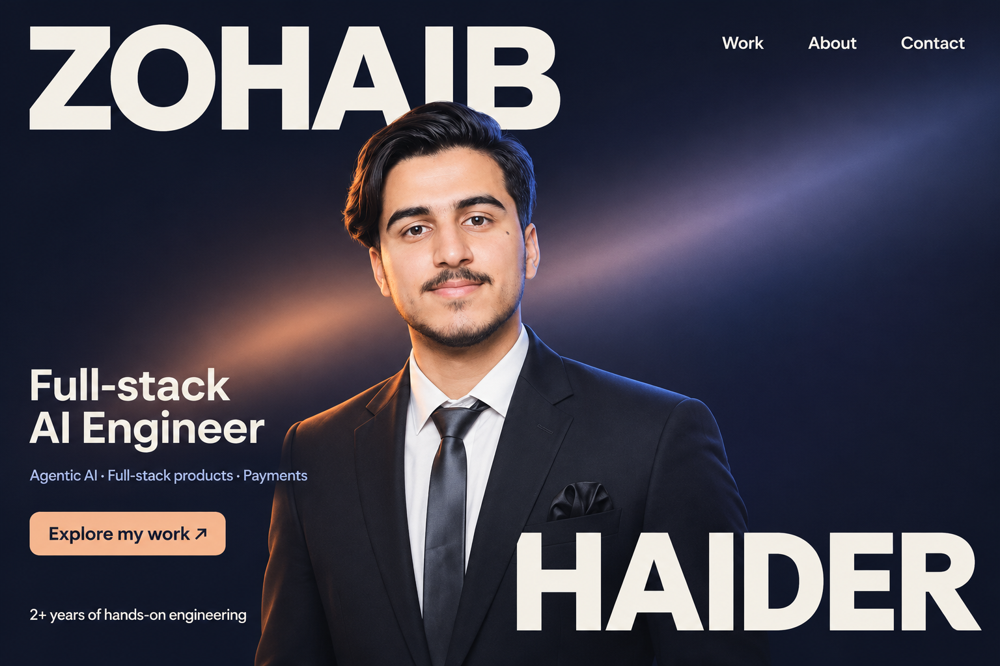
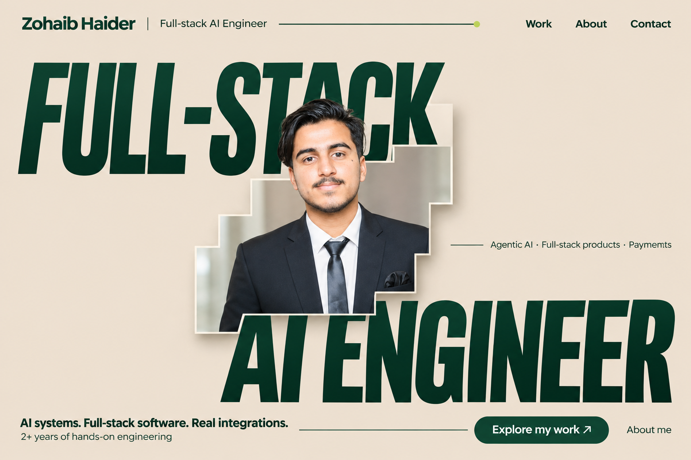

# Round 10 — five original first-screen designs

This round contains only the landing viewport. No project section, about section, capability map, or technology inventory appears underneath the hero. The visual ideas take inspiration from the supplied reference family while using new compositions.

Created using the built-in image generation tool through the imagegen skill. These are static visual concepts; the motion directions below describe a later implementation. Exact generation prompts are saved in [prompts.json](./prompts.json). The original source portrait is the identity reference.

## 39 — Axis / Cobalt + Ivory

**Composition:** oversized role typography and an original diagonal color plane connect the portrait to the introduction.

**Typography:** condensed sans-serif headlines balanced with normal-width UI and body text.

**Proposed motion:** shallow movement between type, portrait, and backing plane, followed by a coordinated reveal into the work.

## 40 — Tempo / Coral + Charcoal

**Composition:** three unequal horizontal color fields, offset role typography, and a portrait crossing their boundaries.

**Typography:** refined condensed display text with clean, readable supporting copy.

**Proposed motion:** horizontal typographic reveals and restrained parallax between the photograph and color fields.

## 41 — Monolith / Ink + Limestone

**Composition:** a vertical typographic spine, asymmetric photograph, personal name, and a restrained navigation rail.

**Typography:** a condensed vertical anchor paired with broad horizontal name typography and a stable role label.

**Proposed motion:** controlled photo depth and typographic masking while the identity remains readable.

## 42 — Pulse / Midnight + Apricot

**Composition:** diagonal name placement, a recognizable portrait, and a single photographic light sweep through a quiet dark canvas.

**Typography:** a slightly expanded contemporary grotesk, with carefully separated name and role scales.

**Proposed motion:** a slow light-field evolution and shallow photographic parallax.

## 43 — Form / Sand + Forest

**Composition:** offset type baselines frame a stepped portrait mask with a single restrained backing plane.

**Typography:** bold but optically balanced sans-serif role text and fine supporting UI.

**Proposed motion:** a coordinated reveal of the architectural photo mask and type, with a small moving accent.

## Shared first-screen content

- Zohaib Haider — Full-stack AI Engineer.
- One short scope line: agentic AI, full-stack products, and payments.
- Work, About, and Contact navigation; a clear action to explore the work.
- Original portrait identity, without added glasses or a substitute face.
- At most one small experience line; no dense proof counters or dependency list.

All four project case studies and detailed engineering evidence remain available for a future page design below the hero. No portfolio source implementation is changed in this round.
